<h1 align="center">
  
</h1>

<p align="center">
  
  &nbsp;
  <a href="https://www.linkedin.com/in/mohd-azim-922373204/">
    
  </a>
  &nbsp;
  
</p>

---

<p align="center">
  
</p>

## 👨‍💻 About Me

```java
public class MohdAzim extends BackendEngineer {

    String location       = "Delhi, India 🇮🇳";
    String experience     = "3+ years in enterprise backend engineering";

    String currentRole    = "Senior Software Engineer @ Quess Corp";
    String client         = "Airtel Payments Bank";
    String currentProject = "Banking Onboarding & CKYC";

    String[] superPowers = {
        "Distributed Systems",
        "System Design (HLD/LLD)",
        "High-Throughput Backend Systems",
        "DSA"
    };

    boolean openToWork = true;

    String funFact() {
        return "Migrated a Java 1.6 monolith to Java 21 — zero downtime 🚀";
    }
}
```

- 🏢 **Currently:** Senior Software Engineer at Quess Corp — Client: Airtel Payments Bank
- 🏦 **Working On:** Banking Customer Onboarding & CKYC (Central KYC) Platform
- 📅 **Experience:** October 2026 – Present at Quess Corp
- 🏗️ **What I Build:** Scalable backend services, distributed platforms, and enterprise applications
- ⚙️ **Backend Engineering:** Java, Spring Boot, Microservices, REST APIs
- 🚀 **Distributed Technologies:** Apache Kafka, Redis, Aerospike, Elasticsearch
- 📊 **Observability:** ELK Stack, Kibana, Grafana, Prometheus
- 🧠 **Deep in:** System Design · HLD · LLD · DSA · Distributed Systems
- ☁️ **Cloud Journey:** AWS (EC2, S3, Lambda, Bedrock)
- 🤖 **AI-Curious:** RAG Architectures, Agentic Workflows, OpenAI API & LLM Integration

---

## 👨‍💻 Developer Workspace

<p align="center">
  
</p>

---

## 🛠️ Tech Arsenal

**Core Languages**


**Backend & Frameworks**


**Architecture Patterns**


**Distributed Stack & Databases**


**Logging, Monitoring & Observability**


**Cloud & DevOps**

-%23FF9900.svg?style=for-the-badge&logo=amazon-aws&logoColor=white)


**AI Engineering**


---

## 💼 Professional Experience

### 🏦 Senior Software Engineer — Quess Corp
`Client: Airtel Payments Bank` `October 2026 – Present`

**Project: Banking Onboarding & CKYC Platform**

`Java` `Spring Boot` `Microservices` `Elasticsearch` `Aerospike` `ELK Stack` `Kibana` `Grafana` `Prometheus`

> Working on enterprise banking onboarding and Central KYC (CKYC) systems for Airtel Payments Bank, focusing on backend engineering, distributed data technologies, search capabilities, and application observability.

**Technology Stack:**
- **Backend:** Java, Spring Boot, REST APIs, Microservices
- **Search & Data:** Elasticsearch, Aerospike
- **Logging & Monitoring:** ELK Stack, Kibana, Grafana, Prometheus

---

## 🚀 Key Scaling Projects

### 📡 Vodacom Tanzania CRBT Platform
`Spring Boot 3.x` `Apache Kafka` `Redis` `REST APIs` — *Rollout Phase*

> Architected highly concurrent REST sub-services managing cross-network multi-tenant OTP validation loops for a platform base of **27.7M users** — strict memory limits maintained throughout.

---

### 🌐 Ncell Nepal PRBT Platform
`Java` `Spring Boot` `MySQL` `Provisioning Frameworks` — *Live Production*

> Designed the core MSISDN billing module and automated background network callback triggers, scaling to sustain **50,000+ active paid premium subscribers** smoothly.

---

### 🏢 Enterprise Trade Lifecycle Automation Engine
`Java` `Openlink Endur` `Core Libraries` — *Internal Tooling*

> Developed standalone Java execution components to automate structured transaction logging, mitigating manual input errors inside commodity delivery tracking systems.

---

## 📊 GitHub Stats

<p align="center">
  
</p>

<p align="center">
  
  &nbsp;
  
</p>

---

## 🏅 Certifications

- 🟦 **Microsoft Certified:** Azure Fundamentals (AZ-900)
- 🟨 **IBM Certified:** SQL & Relational Databases Mastery Expert
- 🟩 **Industry Endorsed:** Advanced Spring Boot 3 & Hibernate Enterprise Architecture

---

## 📬 Let's Connect

<p align="center">
  <a href="mailto:mohdazim6309@gmail.com">
    
  </a>
  &nbsp;
  <a href="https://www.linkedin.com/in/mohd-azim-922373204/">
    
  </a>
  &nbsp;
  <a href="tel:+917052909929">
    
  </a>
</p>

<p align="center">
  <b>⚡ Senior Backend Engineer · Building Scalable Banking & Distributed Systems</b>
</p>

<p align="center">
  
</p>
